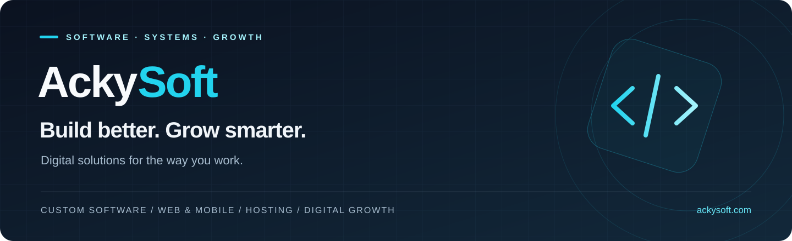

  

  <strong>Practical software. Connected experiences. Room to grow.</strong> 
  We help businesses and organizations simplify operations and build their digital presence.

  
  
  

---

### Technology that works for you

From a shop’s first inventory system to an organization’s next digital platform, we turn everyday challenges into useful software. Our work spans retail, education, healthcare, and growing businesses.

### What we build

<table>
  <tr>
    <td width="50%" valign="top">
      <h3>⚙️ Custom software</h3>
      
Tools shaped around your workflows: point of sale, inventory, accounting, HR, and management systems.

    </td>
    <td width="50%" valign="top">
      <h3>↗ Web &amp; mobile</h3>
      
Business websites, e-commerce platforms, iOS and Android apps, and progressive web apps.

    </td>
  </tr>
  <tr>
    <td width="50%" valign="top">
      <h3>☁️ Hosting &amp; infrastructure</h3>
      
Web and business email hosting, server management, monitoring, and ongoing support.

    </td>
    <td width="50%" valign="top">
      <h3>✦ Digital growth</h3>
      
Branding, SEO, content strategy, social media management, and digital advertising.

    </td>
  </tr>
</table>

### Our products & active projects

At AckySoft, we are continuously developing, testing, and improving digital platforms that solve real operational challenges for businesses and organizations.

#### 📱 eWakala — Mobile Money Agency Management

eWakala is a digital management system built for **Mobile Money Agents and Super Agents**. It helps agency businesses track cash and float balances, organize mobile money accounts, and monitor day-to-day operations with clearer financial visibility. Our goal is to make agency management more organized, efficient, and easier to scale.

#### 💼 eKusanya — Collections & Loan Management

eKusanya helps businesses and organizations **manage loan collections, customer records, payments, and financial reports** in one digital workspace. It is designed to simplify collection processes, improve record-keeping, and help teams follow up on outstanding payments with better visibility into business performance.

#### 🎉 eSherehe — Event Management Platform

eSherehe is a digital platform focused on **organizing and managing events and related workflows**. It aims to reduce manual administrative work, improve coordination, and give organizers a more structured way to handle event activities.

#### ⛪ MunguMe — Church & Ministry Management

MunguMe is a digital solution designed to support **churches, ministries, and faith-based organizations** in managing their activities and administrative processes. The platform focuses on making day-to-day coordination and record management more accessible and efficient.

> **Project note:** Some products are undergoing active testing and improvements. Repository access and source-code availability depend on each project's visibility and permissions.

### In the spotlight · AckySHINE

An AI-powered digital companion focused on personal growth, inspiration, and guidance.

[Discover AckySHINE and our work →](https://ackysoft.com/)

### From first conversation to ongoing support

**Discover → Plan → Build → Test → Launch → Support**

We start with your needs, develop a practical plan, and carry the work through delivery and support.

### Explore the code

Project repository links can be added above as they become available. Some active repositories are private and can only be accessed by authorized collaborators. For setup, contribution guidance, and licensing, see the documentation in each accessible repository.

---

  <strong>Have a workflow to simplify or a product to build?</strong> 
  <a href="https://ackysoft.com/contacts">Let’s talk about your project →</a>

  <a href="https://ackysoft.com/">Website</a> &nbsp;·&nbsp;
  <a href="https://ackysoft.com/about">About us</a> &nbsp;·&nbsp;
  <a href="mailto:info@ackysoft.com">info@ackysoft.com</a> 
  Dar es Salaam, Tanzania · Working with clients worldwide

