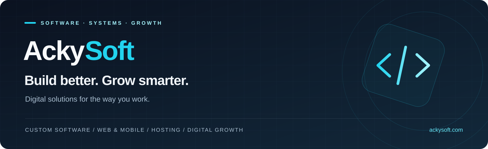

  

  <strong>Practical software. Connected experiences. Room to grow.</strong> 
  We help businesses and organizations simplify operations and build their digital presence.

  
  
  

---

### Technology that works for you

From a shop’s first inventory system to an organization’s next digital platform, we turn everyday challenges into useful software. Our work spans retail, education, healthcare, and growing businesses.

### What we build

<table>
  <tr>
    <td width="50%" valign="top">
      <h3>⚙️ Custom software</h3>
      
Tools shaped around your workflows: point of sale, inventory, accounting, HR, and management systems.

    </td>
    <td width="50%" valign="top">
      <h3>↗ Web &amp; mobile</h3>
      
Business websites, e-commerce platforms, iOS and Android apps, and progressive web apps.

    </td>
  </tr>
  <tr>
    <td width="50%" valign="top">
      <h3>☁️ Hosting &amp; infrastructure</h3>
      
Web and business email hosting, server management, monitoring, and ongoing support.

    </td>
    <td width="50%" valign="top">
      <h3>✦ Digital growth</h3>
      
Branding, SEO, content strategy, social media management, and digital advertising.

    </td>
  </tr>
</table>

### In the spotlight · AckySHINE

An AI-powered digital companion focused on personal growth, inspiration, and guidance.

[Discover AckySHINE and our work →](https://ackysoft.com/)

### From first conversation to ongoing support

**Discover → Plan → Build → Test → Launch → Support**

We start with your needs, develop a practical plan, and carry the work through delivery and support.

### Explore the code

Browse this organization’s public repositories to see what is available. For setup, contribution guidance, and licensing, check the documentation in each repository.

---

  <strong>Have a workflow to simplify or a product to build?</strong> 
  <a href="https://ackysoft.com/contacts">Let’s talk about your project →</a>

  <a href="https://ackysoft.com/">Website</a> &nbsp;·&nbsp;
  <a href="https://ackysoft.com/about">About us</a> &nbsp;·&nbsp;
  <a href="mailto:info@ackysoft.com">info@ackysoft.com</a> 
  Dar es Salaam, Tanzania · Working with clients worldwide

